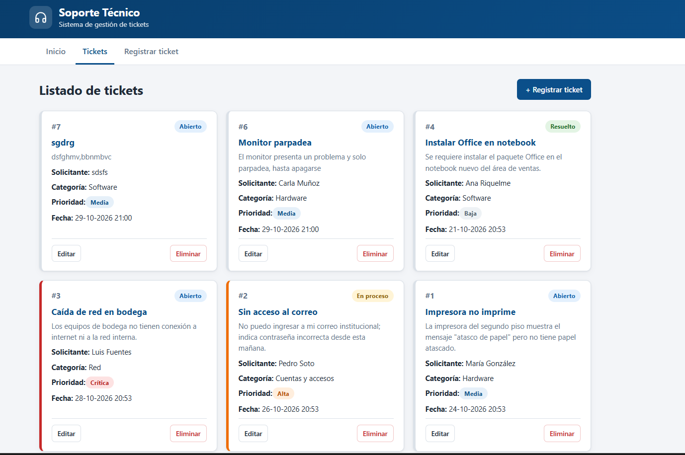
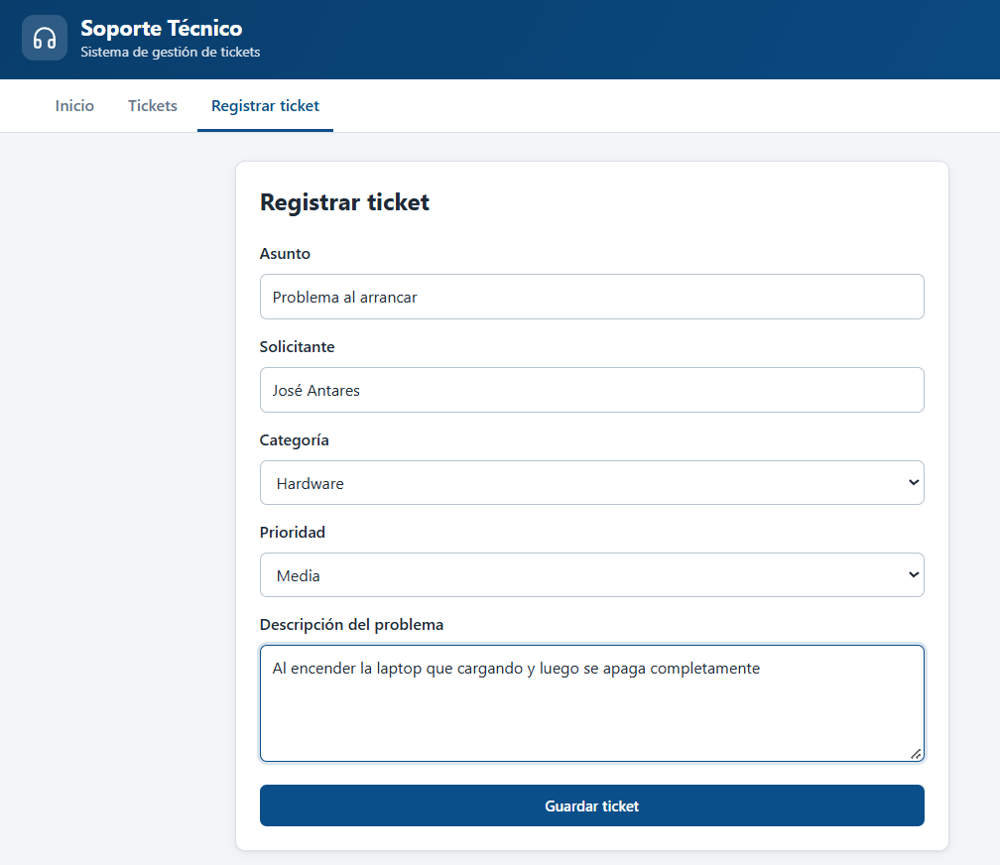
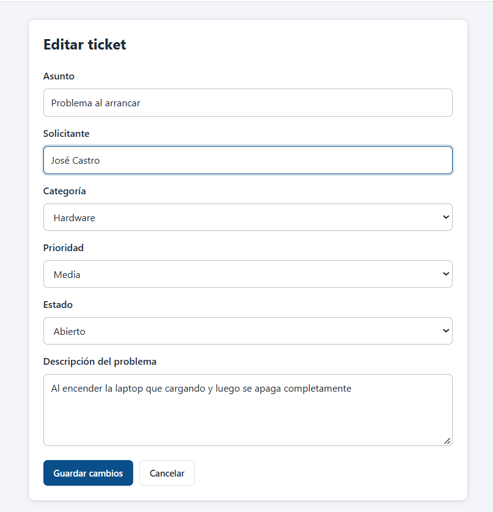
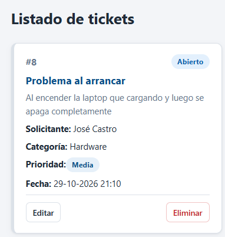
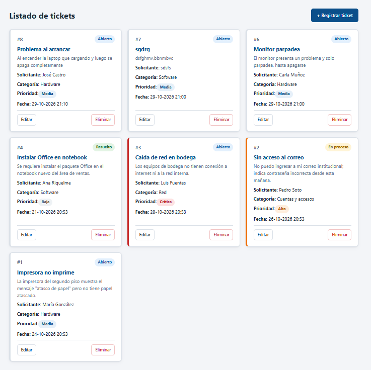

Sistema de Gestión de Soporte Técnico
Aplicación web full stack para registrar, consultar, actualizar y eliminar tickets de soporte técnico. Reemplaza el registro manual en mensajes y planillas. Los datos se guardan en una base de datos SQL Server.

Evaluación N.° 2 · Electivo Angular · Ingeniería en Informática · Instituto Profesional Virginio Gómez, sede Chillán.
```
NAVEGADOR
│
▼
ANGULAR 22 http://localhost:4200
│ HTTP / JSON
▼
API REST http://localhost:3000
Node.js + Express
│ SQL
▼
SQL SERVER
soporte_db → tabla tickets
```

1. Autor
Nombre	Marcos Salazar
Carrera	Ingeniería en Informática
Asignatura	Electivo Angular
Repositorio	https://github.com/Marcos-DRK/soporte-tickets.git
2. Tecnologías utilizadas
Capa	Tecnología	Uso
Frontend	Angular 22 (componentes, rutas, Reactive Forms, HttpClient)	Interfaz de usuario
Backend	Node.js + Express	API REST
Conexión BD	mssql + msnodesqlv8	Consultas a SQL Server con el usuario de Windows
Base de datos	SQL Server LocalDB	Persistencia
Otros	cors	Permite que Angular (puerto 4200) consuma la API (puerto 3000)
El proyecto sigue la estructura de la guía de clases Actividad 06 – Biblioteca Digital, adaptada a tickets de soporte y a SQL Server.

¿Por qué SQL Server en lugar de MySQL?
La evaluación permite usar "MySQL u otra base de datos equivalente". Elegí SQL Server porque es un motor relacional equivalente a MySQL, es muy usado en empresas, se puede usar gratis (LocalDB) y se administra con SQL Server Management Studio, ademas, era la base de datos con la que mas proyectos he hecho.
 
3. Estructura del proyecto
```
soporte-tickets/
├── README.md
├── .gitignore
├── database/
│ └── soporte_db.sql ← crea la BD, la tabla tickets y 5 tickets de ejemplo
├── api-soporte-sqlserver/ ← BACKEND (Node.js + Express)
│ ├── .npmrc ← evita que npm intente compilar msnodesqlv8
│ ├── db.js ← conexión a SQL Server
│ ├── package.json
│ └── server.js ← endpoints GET, POST, PUT y DELETE
└── soporte-angular/ ← FRONTEND (Angular 22)
└── src/
├── styles.css ← estilos globales (colores, botones, insignias)
└── app/
├── components/
│ ├── cabecera/
│ ├── menu/
│ ├── inicio/
│ ├── tickets/ ← listado y eliminación
│ ├── nuevo-ticket/ ← registro
│ └── editar-ticket/ ← edición
├── models/ticket.ts
├── services/tickets.ts
├── app.config.ts
├── app.routes.ts
├── app.ts
└── app.html
```

4. Modelo de datos
Tabla tickets:

Campo	Tipo	Regla
id	INT IDENTITY(1,1)	Clave primaria autoincremental
asunto	NVARCHAR(150)	Obligatorio
solicitante	NVARCHAR(100)	Obligatorio
descripcion	NVARCHAR(1000)	Obligatorio
categoria	NVARCHAR(30)	Hardware, Software, Red, Cuentas y accesos, Otro
prioridad	NVARCHAR(10)	Baja, Media, Alta, Crítica
estado	NVARCHAR(20)	Abierto (por defecto), En proceso, Resuelto, Cerrado
fechaRegistro	DATETIME2(0)	La asigna SQL Server al registrar
5. API REST
Método	Ruta	Descripción	Respuestas
GET	/api/tickets	Lista todos los tickets	200 · 500
GET	/api/tickets/:id	Obtiene un ticket	200 · 400 · 404
POST	/api/tickets	Registra un ticket	201 · 400
PUT	/api/tickets/:id	Actualiza un ticket	200 · 400 · 404
DELETE	/api/tickets/:id	Elimina un ticket	200 · 400 · 404
Todas las consultas usan parámetros (@id, @asunto…) con .input(). Los datos del usuario nunca se concatenan en el SQL, lo que evita la inyección SQL.

6. Instalación
Requisitos: Node.js, Angular CLI 22, SQL Server LocalDB, SQL Server Management Studio y ODBC Driver 18 for SQL Server.

1. Base de datos. En la carpeta raíz del proyecto:

```bash
sqllocaldb start MSSQLLocalDB
sqlcmd -S "(localdb)\MSSQLLocalDB" -E -f 65001 -i database\soporte_db.sql
```

2. Backend:

```bash
cd api-soporte-sqlserver
npm install
```

3. Frontend:

```bash
cd soporte-angular
npm install
```

7. Ejecución
Orden	Terminal	Comando	Resultado
1	Cualquiera	sqllocaldb start MSSQLLocalDB	SQL Server activo
2	Terminal 1, en api-soporte-sqlserver	node server.js	API en http://localhost:3000
3	Terminal 2, en soporte-angular	ng serve -o	Aplicación en http://localhost:4200
8. Funcionalidades implementadas
Listado de tickets obtenidos desde SQL Server.
Registro de tickets con formulario y validaciones (campos obligatorios y largo mínimo).
Edición de tickets, incluido el cambio de estado.
Eliminación con confirmación previa.
Colores distintos para cada estado y prioridad.
Mensaje de error cuando la API no responde, con botón Reintentar.
Los datos se mantienen al recargar Angular y al reiniciar la API.
9. Pruebas realizadas
Prueba	Acción	Resultado esperado	Resultado
Inicio	Ejecutar BD, API y Angular	Los tres funcionan	✅
GET	Abrir Tickets y http://localhost:3000/api/tickets	Se listan los tickets de SQL Server	✅
POST	Registrar un ticket desde Angular	Aparece en el listado y en la BD	✅
PUT	Editar un ticket y recargar	El cambio permanece	✅
DELETE	Eliminar un ticket y confirmar	Desaparece del listado y de la BD	✅
Validación	Enviar el formulario vacío	Aparecen mensajes bajo los campos	✅
Error	Detener la API y abrir Tickets	Mensaje de error y botón Reintentar	✅
Persistencia	Reiniciar la API	Los tickets siguen ahí	✅
Compilación	ng build	Sin errores	✅
Aqui se muestra el listado de los tickets

En esta imagen podemos ver como se crea

Aquí vemos como se Edita el nombre y luego se ve el ticket con el cambio realizado


Como se ve en la siguiente imagen no esta el ticket numero 5, porque este fue eliminado de la lista


10. Declaración de uso de Inteligencia Artificial
Complete y corrija esta sección con lo que usted realmente hizo antes de entregar.
Ítem	Detalle
Herramienta	Claude (Anthropic), mediante Claude Code
Actividades	Estructurar el trabajo según la rúbrica y adaptar la guía de clases (Biblioteca Digital, MySQL) al caso de tickets con SQL Server
Elementos con apoyo de IA	Script SQL para SQL Server, conexión con mssql, endpoints de la API, componentes Angular, estilos CSS y este README
Modificaciones y verificaciones propias	
Yo me encargue de ir revisando el codigo y la base de datos, verificando que se guardarán bien los datos, ademas, probe el CRUD que funcionara bien, ademas verifique que al contruir funcionara, la base de datos (las fui encendiendo por separado), el frontend y la API.
Puedo explicar, ubicar y modificar cualquier parte del código sin usar IA.